Regorus uses the following grammar that has been derived from the official [OPA grammar](https://www.openpolicyagent.org/docs/latest/policy-reference/#grammar) as well as observed OPA behavior.

Regorus intentionally rejects direct negated assignment (`not x := value`) and
negated unification (`not x = value`). Use `not x == value` for negated equality.
The unification restriction is stricter than OPA; it is not a claim that OPA
rejects all such policies. Positive `=` and `:=` filters inside a comprehension
or `every` body remain allowed when the enclosing expression is negated.

## Parsing nested expressions

The parser limits recursive terms and query bodies to a shared depth of 32 and
also checks the depth of the resulting expressions and queries. Plain terms such
as `[[1]]` use three levels. A comprehension such as `[0 | true]` also opens a
query body, so nested comprehensions reach the limit sooner than nested arrays.
The query-body guard also bounds nested `every` bodies without charging a second
slot for the same statement. Sibling terms close their slot before the next
starts, so wide shallow arrays and queries do not add to the nesting depth.
Excessive nesting returns an `expression nesting too deep` error, not
`Undefined`. A rejected policy is not added to the engine, which remains usable.

Before trying a comprehension or assignment, an iterative lookahead checks for
`|`, `=`, or `:=` after the first reference. It skips nested delimiters and does
not treat string contents as separators. For example, `[0 | [0 | true]]` must not
parse each inner query again while checking whether the outer expression is an
assignment. The scan stops at the reference boundary rather than reading all
later statements, keeping long sequences of shallow statements inexpensive.

This lookahead does not change the grammar or depth limits. In particular,
parenthesized string indices in calls (`f[("k")](1)`) and multiline unary
unification (`-` followed on the next line by `1 = -1`) remain supported.
Depth errors and typed resource-limit errors are preserved across parsing
fallbacks. These limits are separate from host `Value` limits and RVM rule-call
limits; they are not a guarantee for arbitrary native stack sizes.

```ebnf

module           ::= package  imports rule*
package          ::= 'package' path-ref
imports          ::= ( 'import' path-ref ( 'as' var )? )*
path-ref         ::= path-ref NO_WS '.' NO_WS IDENT
                 | path-ref NO_WS '[' STRING ']'
                 | IDENT
rule             ::= default-rule
                 | spec-rule
default-rule     ::= 'default' rule-ref assign-op term
spec-rule        ::= rule-head rule-bodies
rule-head        ::= func-rule
                 | contains-rule
                 | object-rule
                 | set-rule
                 | compr-rule
func-rule        ::= rule-ref '(' term ( ',' term )* ','? ')' rule-assign?
contains-rule    ::=  rule-ref 'contains' or-expr
object-rule      ::= rule-ref NO_WS '[' membership-expr ']' rule-assign
set-rule         ::= rule-ref NO_WS '[' membership-expr ']'
compr-rule       ::= rule-ref rule-assign?
rule-ref         ::= rule-ref NO_WS  '.' NO_WS var
                 | path-ref NO_WS '[' membership-expr ']'
                 | var
rule-assign      ::= assign-op membership-expr
rule-bodies      ::=  'if'  '{' query '}' alternatives
                 | 'if' literal-stmt alternatives
                 | '{' query '}' alternatives
alternatives     ::= query-blocks
                 | else-blocks
query-blocks     ::= ( '{' query '}' )*
else-blocks      ::= ( else-block )*
else-block       ::= 'else' rule-assign? 'if' '{' query '}'
                 | 'else' rule-assign? 'if' literal-stmt
                 | 'else' rule-assign? '{' query '}'
assign-op        ::= '=' | ':='
query            ::= literal-stmt ( sep  literal-stmt )*
sep              ::= ';' | '\n' | '\r\n'
literal-stmt     ::= literal with-modifiers
with-modifiers   ::= ( 'with' path-ref 'as' in-expr )*
literal          ::= some
                 | every
                 | expr
                 | not-expr
some             ::= some-vars
                 | some-in
some-vars        ::= 'some' var ( ',' var )*
some-in          ::= 'some' ref ( ',' ref )? 'in'
every            ::= 'every' var ( ',' var )? 'in' bool-expr '{' query '}'
expr             ::= assign-expr
not-expr         ::= 'not' membership-expr
assign-expr      ::= ref assign-op membership-expr
membership-expr  ::=  membership-expr 'in' bool-expr
                 | bool-expr ',' bool-expr
                 | bool-expr
in-expr          ::= in-expr 'in' bool-expr
                 | bool-expr
bool-expr        ::= bool-expr bool-op or-expr
                 | or-expr
bool-op          ::= '<' | '<=' | '==' | '>=' | '>' | '!='
set-union-expr   ::= set-union-expr '|' set-intersection-expr
                 | set-intersection-expr
set-intersection-expr ::= set-intersection-expr '&' arith-expr
                 | arith-expr
arith-expr       ::= arith-expr ('+' | '-') mul-div-expr
                 | mul-div-expr
mul-div-expr     ::= mul-div-expr ('*' | '/') term
                 | term
term             ::= ref
ref              ::= scalar-or-var
                 | compr-set-or-object
                 | compr-or-array
                 | unary-expr
                 | parens-expr
                 | ref-dot
                 | ref-brack
                 | call-expr
ref-dot          ::= ref NO_WS '.' NO_WS var
ref-brack        ::= ref NO_WS '[' in-expr ']'
call-expr        ::= path-ref NO_WS '(' call-args  ','? ')'
call-args        ::= in-expr ( ',' in-expr )*
parens-expr      ::= '(' membership-expr ')'
unary-expr       ::= '-' in-expr
compr-set-or-object ::= set-compr
                    | set
                    | object-compr
                    | object
set-compr        ::= '{' compr '}'
set              ::= '{' in-expr  ( ',' in-expr )* ','? '}'
                 | 'set(' ')'
object           ::= '{' field ( ',' field )* ','? '}'
                 | '{' '}'
field            ::= in-expr ':' in-expr
compr-or-array   ::= array-compr
                 | array
array-compr      ::= '[' compr ']'
array            ::= '[' in-expr ( ',' in-expr )* ','? ']'
                 | '[' ']'  
compr            ::= ref '|' query
scalar-or-var    ::= var
                 | NUMBER
                 | STRING
                 | RAWSTRING
                 | 'null'
                 | 'true'
                 | 'false'
var              ::= IDENT
                 | non-imported-future-keyword
non-imported-future-future-keyword ::= 'contains' | 'every' | 'if' | 'in'

```

Below is the RailRoad Diagram for the grammar.

**module:**

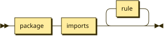

```
module   ::= package imports rule*
```

**package:**

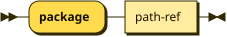

```
package  ::= 'package' path-ref
```

referenced by:

* module

**imports:**

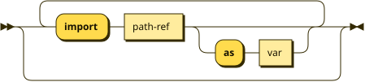

```
imports  ::= ( 'import' path-ref ( 'as' var )? )*
```

referenced by:

* module

**path-ref:**

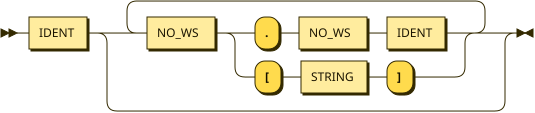

```
path-ref ::= IDENT ( NO_WS ( '.' NO_WS IDENT | '[' STRING ']' ) )*
```

String components in brackets retain their literal identity, including dots.
For example, `graph["a.b"]` is distinct from `graph.a.b`. When a package path
is returned by the Engine API or used as a rule entry point, non-identifier
string components use JSON-escaped bracket notation.

Policy-source path references are limited to 32 components, counting the
initial identifier as one. Every dotted identifier or bracketed string adds
one component; dots inside a bracketed string do not. A 33rd component is
rejected by the general policy parser.

The Rego frontend also limits expression/query nesting and constructed AST
height to 32. Scalars have height one; each expression or query adds one to
the largest child height. Statement lists do not add height per sibling.
This includes general references and operator chains, not just parentheses.
Parenthesized grammar nesting is checked separately, before speculative
parsing. Unsupported structures return parser errors.

The interpreter has a separate private budget of 64 simultaneously active
evaluation entries, shared by expressions, rules/functions, destructuring and
native loop continuations. Exhaustion is an evaluation error, including in non-strict mode;
it is not false, undefined, or a request to select a default. Ordinary statement
iteration does not consume an entry per statement. These structural and native
budgets are not limits on the depth of input/data Values.

The RVM compiler also enforces its existing rule-tree path limit. A policy may
parse successfully yet fail RVM compilation when its combined registered path
exceeds that limit; direct entry-point lookup does not bypass this check.

Static public entry-point lookup uses a separate iterative parser rather than
building the recursively nested policy AST. It accepts dotted and bracketed
string spellings up to the longest registered rule path, so equivalent
spellings remain consistent even when that path exceeds the policy parser's
32-component limit. Paths that exceed the registered depth or do not identify
a rule remain invalid; `Engine::eval_rule` reports `not a valid rule path`,
while parser and compiler APIs return an error.

referenced by:

* call-expr
* imports
* package
* rule-ref
* with-modifiers

**rule:**

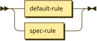

```
rule     ::= default-rule
           | spec-rule
```

referenced by:

* module

**default-rule:**

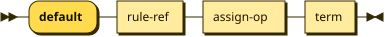

```
default-rule
         ::= 'default' rule-ref assign-op term
```

referenced by:

* rule

**spec-rule:**

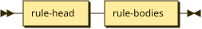

```
spec-rule
         ::= rule-head rule-bodies
```

referenced by:

* rule

**rule-head:**

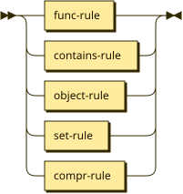

```
rule-head
         ::= func-rule
           | contains-rule
           | object-rule
           | set-rule
           | compr-rule
```

referenced by:

* spec-rule

**func-rule:**

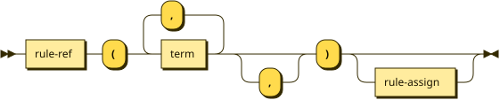

```
func-rule
         ::= rule-ref '(' term ( ',' term )* ','? ')' rule-assign?
```

referenced by:

* rule-head

**contains-rule:**

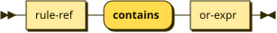

```
contains-rule
         ::= rule-ref 'contains' or-expr
```

referenced by:

* rule-head

**object-rule:**

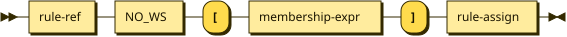

```
object-rule
         ::= rule-ref NO_WS '[' membership-expr ']' rule-assign
```

referenced by:

* rule-head

**set-rule:**

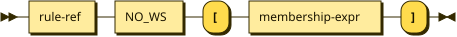

```
set-rule ::= rule-ref NO_WS '[' membership-expr ']'
```

referenced by:

* rule-head

**compr-rule:**

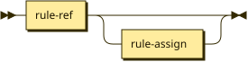

```
compr-rule
         ::= rule-ref rule-assign?
```

referenced by:

* rule-head

**rule-ref:**

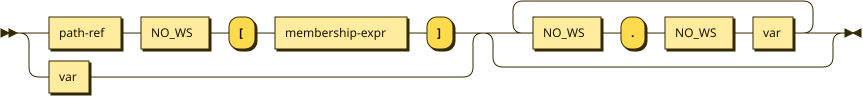

```
rule-ref ::= ( path-ref NO_WS '[' membership-expr ']' | var ) ( NO_WS '.' NO_WS var )*
```

referenced by:

* compr-rule
* contains-rule
* default-rule
* func-rule
* object-rule
* set-rule

**rule-assign:**

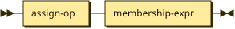

```
rule-assign
         ::= assign-op membership-expr
```

referenced by:

* compr-rule
* else-block
* func-rule
* object-rule

**rule-bodies:**

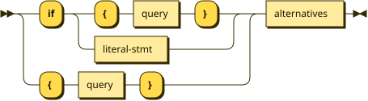

```
rule-bodies
         ::= ( 'if' ( '{' query '}' | literal-stmt ) | '{' query '}' ) alternatives
```

referenced by:

* spec-rule

**alternatives:**

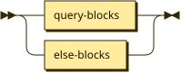

```
alternatives
         ::= query-blocks
           | else-blocks
```

referenced by:

* rule-bodies

**query-blocks:**

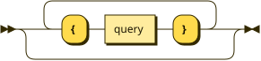

```
query-blocks
         ::= ( '{' query '}' )*
```

referenced by:

* alternatives

**else-blocks:**

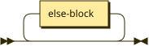

```
else-blocks
         ::= else-block*
```

referenced by:

* alternatives

**else-block:**

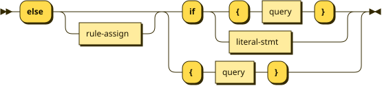

```
else-block
         ::= 'else' rule-assign? ( 'if' ( '{' query '}' | literal-stmt ) | '{' query '}' )
```

referenced by:

* else-blocks

**assign-op:**

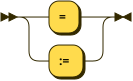

```
assign-op
         ::= '='
           | ':='
```

referenced by:

* assign-expr
* default-rule
* rule-assign

**query:**

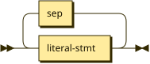

```
query    ::= literal-stmt ( sep literal-stmt )*
```

referenced by:

* compr
* else-block
* every
* query-blocks
* rule-bodies

**sep:**

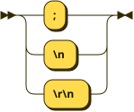

```
sep      ::= ';'
           | '\n'
           | '\r\n'
```

referenced by:

* query

**literal-stmt:**

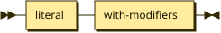

```
literal-stmt
         ::= literal with-modifiers
```

referenced by:

* else-block
* query
* rule-bodies

**with-modifiers:**

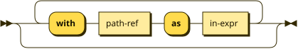

```
with-modifiers
         ::= ( 'with' path-ref 'as' in-expr )*
```

referenced by:

* literal-stmt

**literal:**

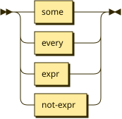

```
literal  ::= some
           | every
           | expr
           | not-expr
```

referenced by:

* literal-stmt

**some:**

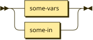

```
some     ::= some-vars
           | some-in
```

referenced by:

* literal

**some-vars:**

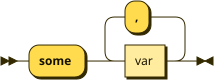

```
some-vars
         ::= 'some' var ( ',' var )*
```

referenced by:

* some

**some-in:**

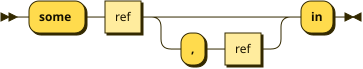

```
some-in  ::= 'some' ref ( ',' ref )? 'in'
```

referenced by:

* some

**every:**

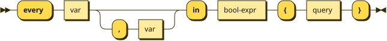

```
every    ::= 'every' var ( ',' var )? 'in' bool-expr '{' query '}'
```

referenced by:

* literal

**expr:**

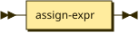

```
expr     ::= assign-expr
```

referenced by:

* literal

**not-expr:**

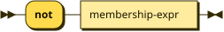

```
not-expr ::= 'not' membership-expr
```

referenced by:

* literal

**assign-expr:**

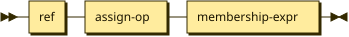

```
assign-expr
         ::= ref assign-op membership-expr
```

referenced by:

* expr

**membership-expr:**

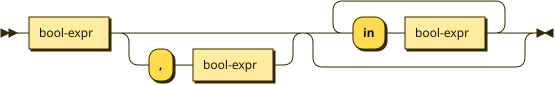

```
membership-expr
         ::= bool-expr ( ',' bool-expr )? ( 'in' bool-expr )*
```

referenced by:

* assign-expr
* not-expr
* object-rule
* parens-expr
* rule-assign
* rule-ref
* set-rule

**in-expr:**

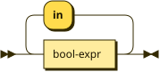

```
in-expr  ::= bool-expr ( 'in' bool-expr )*
```

referenced by:

* array
* call-args
* field
* ref-brack
* set
* unary-expr
* with-modifiers

**bool-expr:**

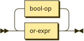

```
bool-expr
         ::= or-expr ( bool-op or-expr )*
```

referenced by:

* every
* in-expr
* membership-expr

**bool-op:**

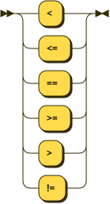

```
bool-op  ::= '<'
           | '<='
           | '=='
           | '>='
           | '>'
           | '!='
```

referenced by:

* bool-expr

**or-expr:**

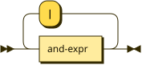

```
or-expr  ::= and-expr ( '|' and-expr )*
```

referenced by:

* bool-expr
* contains-rule

**and-expr:**

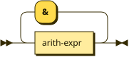

```
and-expr ::= arith-expr ( '&' arith-expr )*
```

referenced by:

* or-expr

**arith-expr:**

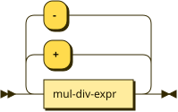

```
arith-expr
         ::= mul-div-expr ( ( '+' | '-' ) mul-div-expr )*
```

referenced by:

* and-expr

**mul-div-expr:**

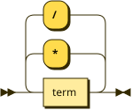

```
mul-div-expr
         ::= term ( ( '*' | '/' ) term )*
```

referenced by:

* arith-expr

**term:**

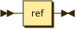

```
term     ::= ref
```

referenced by:

* default-rule
* func-rule
* mul-div-expr

**ref:**

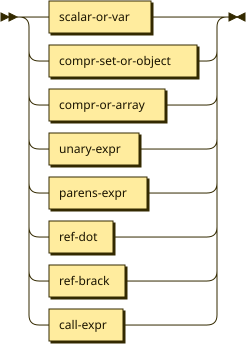

```
ref      ::= scalar-or-var
           | compr-set-or-object
           | compr-or-array
           | unary-expr
           | parens-expr
           | ref-dot
           | ref-brack
           | call-expr
```

referenced by:

* assign-expr
* compr
* ref-brack
* ref-dot
* some-in
* term

**ref-dot:**

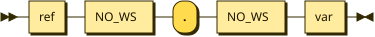

```
ref-dot  ::= ref NO_WS '.' NO_WS var
```

referenced by:

* ref

**ref-brack:**

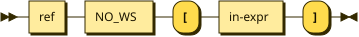

```
ref-brack
         ::= ref NO_WS '[' in-expr ']'
```

referenced by:

* ref

**call-expr:**

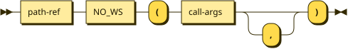

```
call-expr
         ::= path-ref NO_WS '(' call-args ','? ')'
```

referenced by:

* ref

**call-args:**

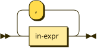

```
call-args
         ::= in-expr ( ',' in-expr )*
```

referenced by:

* call-expr

**parens-expr:**

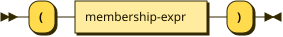

```
parens-expr
         ::= '(' membership-expr ')'
```

referenced by:

* ref

**unary-expr:**

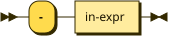

```
unary-expr
         ::= '-' in-expr
```

referenced by:

* ref

**compr-set-or-object:**

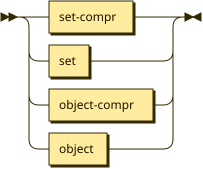

```
compr-set-or-object
         ::= set-compr
           | set
           | object-compr
           | object
```

referenced by:

* ref

**set-compr:**


```
set-compr
         ::= '{' compr '}'
```

referenced by:

* compr-set-or-object

**set:**


```
set      ::= '{' in-expr ( ',' in-expr )* ','? '}'
           | 'set(' ')'
```

referenced by:

* compr-set-or-object

**object:**


```
object   ::= '{' ( field ( ',' field )* ','? )? '}'
```

referenced by:

* compr-set-or-object

**field:**


```
field    ::= in-expr ':' in-expr
```

referenced by:

* object

**compr-or-array:**


```
compr-or-array
         ::= array-compr
           | array
```

referenced by:

* ref

**array-compr:**


```
array-compr
         ::= '[' compr ']'
```

referenced by:

* compr-or-array

**array:**


```
array    ::= '[' ( in-expr ( ',' in-expr )* ','? )? ']'
```

referenced by:

* compr-or-array

**compr:**


```
compr    ::= ref '|' query
```

referenced by:

* array-compr
* set-compr

**scalar-or-var:**


```
scalar-or-var
         ::= var
           | NUMBER
           | STRING
           | RAWSTRING
           | 'null'
           | 'true'
           | 'false'
```

referenced by:

* ref

**var:**


```
var      ::= IDENT
           | non-imported-future-keyword
```

referenced by:

* every
* imports
* ref-dot
* rule-ref
* scalar-or-var
* some-vars

**non-imported-future-future-keyword:**


```
non-imported-future-future-keyword
         ::= 'contains'
           | 'every'
           | 'if'
           | 'in'
```

## 
 <sup>generated by [RR - Railroad Diagram Generator][RR]</sup>

[RR]: https://www.bottlecaps.de/rr/ui
